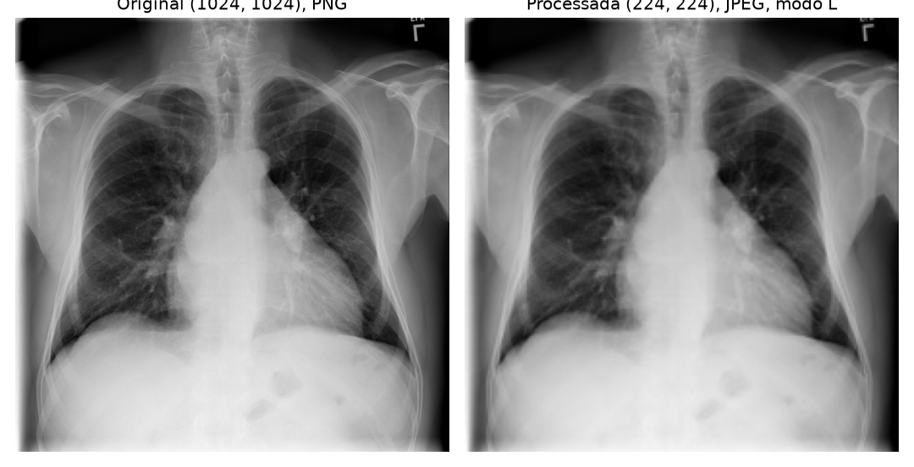
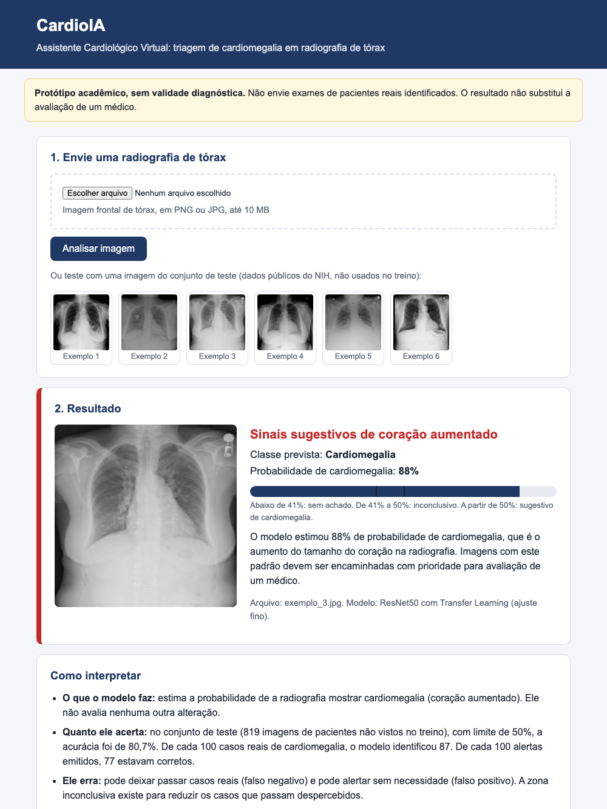

# FIAP - Faculdade de Informática e Administração Paulista

<p align="center">
<a href= "https://www.fiap.com.br/"></a>
</p>

<br>

# CardioIA: Assistente Cardiológico Virtual com Visão Computacional (Fase 4)

## Grupo 15

## 👨‍🎓 Integrantes:
- <a href="https://www.linkedin.com/in/silvio-guerreiro">Silvio Prestes Guerreiro Junior, RM567958</a>

## 👩‍🏫 Professores:
### Tutor(a)
- <a href="https://www.linkedin.com/in/leonardoorabona">Leonardo Ruiz Orabona</a>
### Coordenador(a)
- <a href="https://www.linkedin.com/company/inova-fusca">André Godoi Chiovato</a>

## 🔗 Links da entrega

| Entregável | Link |
|---|---|
| Vídeo do Ir Além 2 (2 min, não listado) | https://youtu.be/Tj1SdRtDy8o |
| Notebook da Parte 1 (pré-processamento) | [`notebooks/01_preprocessamento.ipynb`](notebooks/01_preprocessamento.ipynb) |
| Relatório da Parte 1 (DOCX, 2 páginas) | [`relatorios/relatorio_preprocessamento.docx`](relatorios/relatorio_preprocessamento.docx) |
| Notebook da CNN treinada do zero | [`notebooks/02_cnn_do_zero.ipynb`](notebooks/02_cnn_do_zero.ipynb) |
| Notebook do Transfer Learning (ResNet50) | [`notebooks/03_transfer_learning.ipynb`](notebooks/03_transfer_learning.ipynb) |
| Comparação estatística dos modelos | [`notebooks/03b_comparacao_estatistica.ipynb`](notebooks/03b_comparacao_estatistica.ipynb) |
| Prints das métricas e do protótipo | [`prints/`](prints/) |
| Protótipo em Flask | [`app/`](app/) |
| Ir Além 1: relatório de fairness (DOCX, 2 páginas) | [`relatorios/relatorio_fairness.docx`](relatorios/relatorio_fairness.docx) |
| Ir Além 1: notebook de fairness | [`notebooks/04_fairness.ipynb`](notebooks/04_fairness.ipynb) |
| Ir Além 2: app React Native | [`mobile/`](mobile/) |
| Registro do teste no Google Colab | [`docs/teste_colab_2026-11-20.md`](docs/teste_colab_2026-11-20.md) |
| Modelo treinado (fora do repositório, mais de 100 MB) | [pasta compartilhada do OneDrive](https://1drv.ms/f/c/a655986124216a70/IgB2ySRcJ2-IR7UQIerYZWg9AaFNm9sAIeP-E-NKlcwKu5E?e=ObLTH3) |

## 📜 Descrição

O **CardioIA** é o projeto integrador do curso: uma plataforma digital que simula o ecossistema de uma cardiologia moderna apoiada por Inteligência Artificial. Esta **Fase 4, Cap 1, "Visão Computacional na Clínica"**, acrescenta ao projeto a análise de imagens médicas: um protótipo de Assistente Cardiológico Virtual que recebe uma radiografia de tórax e estima a probabilidade de **cardiomegalia** (coração aumentado).

A entrega cobre o pré-processamento das imagens, o treino e a avaliação de duas redes convolucionais (uma CNN simples treinada do zero e uma ResNet50 com Transfer Learning), um protótipo web que apresenta o resultado em linguagem acessível e os dois desafios Ir Além.

| Parte | O que foi construído | Técnica | Arquivos principais |
|---|---|---|---|
| 1. Pré-processamento e organização das imagens | Seleção de um subconjunto pareado do NIH Chest X-ray, divisão por paciente em treino, validação e teste, conversão para escala de cinza, redimensionamento para 224 x 224, conversão para JPEG, normalização e aumento de dados só no treino | pandas, OpenCV, `ImageDataGenerator` do Keras | `notebooks/01_preprocessamento.ipynb`, `src/nih_remoto.py`, `relatorios/relatorio_preprocessamento.docx` |
| 2. Classificação com CNN | CNN simples treinada do zero e ResNet50 pré-treinada no ImageNet (extração de características e ajuste fino), avaliadas no mesmo conjunto de teste; protótipo Flask com upload de imagem | TensorFlow e Keras, scikit-learn, Flask | `notebooks/02_cnn_do_zero.ipynb`, `notebooks/03_transfer_learning.ipynb`, `notebooks/03b_comparacao_estatistica.ipynb`, `app/` |

### Matriz de rastreabilidade (critérios de avaliação)

| Critério | Pontos | Onde está a evidência |
|---|---|---|
| Pipeline de pré-processamento implementado | 3 | `notebooks/01_preprocessamento.ipynb` (executado, com saídas gravadas), `relatorios/relatorio_preprocessamento.docx`, `data/manifesto.csv`, prints `01` a `05` |
| Treinamento e avaliação de CNN do zero | 2 | `notebooks/02_cnn_do_zero.ipynb`, `data/resultados_cnn_do_zero.json`, prints `06` a `09` |
| Implementação de Transfer Learning funcional | 2 | `notebooks/03_transfer_learning.ipynb` (o que foi congelado e o que foi ajustado, na seção de análise), `data/resultados_resnet50.json`, prints `10` a `12` |
| Apresentação dos resultados em protótipo simples | 2 | `app/app.py` e `app/templates/index.html`; prints `13` e `14` |
| Documentação clara | 1 | Este README, células de texto dos notebooks, os dois relatórios e `mobile/README.md` |
| Trabalho em equipe (ponto extra) | 1 | Não se aplica: entrega individual |

### Relação com as fases anteriores

| Fase | Relação com esta entrega |
|---|---|
| Fase 1, Batimentos de Dados ([repositório](https://github.com/silvioguerreiro/FIAP_1TIAOS_2026_Ano2_Fase1)) | Curou as bases de dados cardiológicos e fixou os princípios de governança e LGPD, aplicados aqui na escolha de um dataset público e anonimizado |
| Fase 2, Diagnóstico Automatizado ([repositório](https://github.com/silvioguerreiro/FIAP_2TIAOR_2026_Ano2_Fase2)) | Triagem por texto dos sintomas; esta fase acrescenta a triagem por imagem |
| Fase 3, Monitoramento Contínuo ([repositório](https://github.com/silvioguerreiro/FIAP_2TIAOR_2026_Ano2_Fase3)) | Sinais vitais de um wearable simulado; esta fase acrescenta a radiografia como nova fonte de informação |

## 🗂️ Dataset

**NIH Chest X-ray (ChestX-ray14)**, do NIH Clinical Center: 112.120 radiografias frontais de 30.805 pacientes anonimizados, com 14 achados rotulados por mineração de texto dos laudos, mais idade, sexo e posição de aquisição. É o dataset citado como exemplo no enunciado.

- Fonte original: https://nihcc.app.box.com/v/ChestXray-NIHCC
- Fonte usada no download: espelho público em https://huggingface.co/datasets/alkzar90/NIH-Chest-X-ray-dataset
- Licença: uso sem restrições, com atribuição ao NIH Clinical Center e citação de Wang et al. (2017), listado nas referências.
- Modelo pré-treinado: ResNet50 com pesos do ImageNet, via Keras Applications (licença Apache 2.0).

**Subconjunto usado:** 5.552 imagens de 4.342 pacientes, 2.776 de Cardiomegalia e 2.776 Sem achado. As negativas foram pareadas com as positivas por posição de aquisição (AP ou PA), sexo e faixa etária, para que a rede não aprenda a distinguir AP de PA em vez de avaliar a silhueta cardíaca.

## 🧹 Parte 1: pré-processamento e organização das imagens

| Etapa | Decisão | Justificativa |
|---|---|---|
| Recorte do problema | Classificação binária, Cardiomegalia x Sem achado | Mantém o vínculo com a cardiologia e cabe em um subconjunto de 2,2 GB (o dataset completo ocupa cerca de 42 GB) |
| Divisão | 70%, 15% e 15% **por paciente**, estratificada por classe, semente 42 | O dataset tem várias imagens por paciente; dividir por imagem causaria vazamento |
| Formato | Escala de cinza de 8 bits, 224 x 224, interpolação por área, JPEG com qualidade 95 | Entrada padrão das redes pré-treinadas vistas em aula; o volume caiu de 2.203 MB para 71 MB |
| Normalização | Reescala para [0, 1] na CNN do zero; `preprocess_input` da ResNet50 no Transfer Learning | Cada rede recebe a normalização do seu treino |
| Aumento de dados | Só no treino: rotação de até 7 graus, deslocamento de até 5%, zoom de até 10% | Variações compatíveis com o posicionamento real; sem espelhamento, que inverteria a anatomia |

| Conjunto | Cardiomegalia | Sem achado | Imagens | Pacientes |
|---|---|---|---|---|
| Treino (70%) | 1.985 | 1.943 | 3.928 | 3.039 |
| Validação (15%) | 389 | 416 | 805 | 651 |
| Teste (15%) | 402 | 417 | 819 | 652 |
| Total | 2.776 | 2.776 | 5.552 | 4.342 |

O notebook verifica por asserção que nenhum paciente aparece em dois conjuntos. O conjunto de teste só é usado na avaliação final.

<p align="center"></p>

## 🧠 Parte 2: classificação com CNN

**CNN do zero:** quatro blocos de convolução 3x3 com ReLU e max pooling (32, 64, 128 e 128 filtros), dropout de 50%, camada densa de 128 neurônios e saída sigmoide. São 3,45 milhões de parâmetros.

**Transfer Learning:** ResNet50 com pesos do ImageNet e nova cabeça de classificação. Na etapa 1 toda a base ficou congelada e só a cabeça foi treinada (taxa de aprendizado de 0,001). Na etapa 2 foi descongelado o último estágio residual (`conv5`), com taxa de 0,00001. Os estágios `conv1` a `conv4` e todas as camadas de Batch Normalization permaneceram congelados.

Avaliação no conjunto de teste (819 imagens, 652 pacientes não vistos no treino), com limiar de decisão 0,5. Entre colchetes, o intervalo de confiança de 95% por bootstrap sobre pacientes.

| Métrica | CNN do zero | ResNet50 (Transfer Learning) |
|---|---|---|
| Acurácia | 0,799 [0,768 a 0,829] | 0,807 [0,776 a 0,836] |
| Precisão | 0,787 [0,734 a 0,833] | 0,770 [0,717 a 0,814] |
| Recall | 0,808 [0,758 a 0,851] | 0,866 [0,825 a 0,901] |
| F1-score | 0,798 [0,754 a 0,834] | 0,815 [0,774 a 0,848] |
| AUC | 0,874 [0,845 a 0,900] | 0,882 [0,855 a 0,906] |
| Falsos negativos / falsos positivos | 77 / 88 | 54 / 104 |
| Parâmetros | 3,45 milhões | 24,1 milhões |
| Épocas e tempo de treino (CPU, Apple M5) | 40 épocas, 33,1 min | 17 épocas, 31,6 min |

**Leitura.** Os dois modelos têm desempenho estatisticamente equivalente em acurácia, F1 e AUC (os intervalos da diferença incluem o zero; McNemar p = 0,61). A ResNet50 tem recall maior no limiar 0,5 (+5,7 pontos), com especificidade menor. Ela foi escolhida para o protótipo por ter o maior AUC de validação e o maior recall, métrica prioritária em triagem, já que o falso negativo é o erro mais grave. Em um segundo treino completo, feito no Google Colab, a diferença de recall caiu para 0,7 ponto e deixou de ser distinguível, portanto essa vantagem depende do treino. Só a extração de características, sem ajuste fino, ficou abaixo da CNN do zero (AUC de validação de 0,822).

<p align="center"></p>

## 🖥️ Protótipo

Aplicação Flask em `app/`. A página recebe uma radiografia (PNG ou JPG) e mostra a classe prevista, a probabilidade, uma barra com as faixas de decisão, uma explicação em linguagem acessível e as limitações do modelo. O resultado é apresentado em três faixas:

| Probabilidade | Resultado |
|---|---|
| abaixo de 41% | Sem achado |
| de 41% a 50% | Inconclusivo, revisão recomendada |
| a partir de 50% | Sugestivo de cardiomegalia |

O limite de 41% foi escolhido no conjunto de validação para manter recall de pelo menos 90%. Há também uma API JSON (`POST /api/predict`, campo `imagem`), consumida pelo app mobile do Ir Além 2.

<p align="center"></p>

## 🧪 Evidências e o que foi verificado

| Evidência | Arquivo | Como foi obtida |
|---|---|---|
| Notebooks com saídas gravadas | `notebooks/01` a `04` | Execução local completa (Apple M5, CPU, Python 3.12), com semente 42 |
| Manifesto das imagens | `data/manifesto.csv` | Gerado pelo notebook 01: conjunto, classe, paciente e metadados de cada imagem |
| Previsões e métricas | `data/pred_*.csv`, `data/resultados_*.json`, `data/comparacao_*.csv` | Gerados pelos notebooks 02, 03 e 03b |
| Prints das métricas | `prints/06` a `prints/12` | Figuras salvas pelos notebooks 02 e 03 |
| Prints do protótipo e do app | `prints/13`, `14` e `16` | Capturas do protótipo e do app em execução |
| Segunda execução completa | `docs/teste_colab_2026-11-20.md` | Os cinco notebooks no Google Colab, em 20/11/2026 |

### Teste no Google Colab

Em 20/11/2026 os cinco notebooks foram executados no Google Colab, em ordem e na mesma máquina, a partir de uma cópia dos arquivos deste repositório colocada em `/content`, sem instalar nenhum pacote. Ambiente: GPU Tesla T4, Python 3.13.16, TensorFlow 2.21.0, Keras 3.13.2, numpy 2.4.6, pandas 2.2.3 e OpenCV 4.14.0. A execução completa levou 71,6 minutos.

| Item | Execução local (Apple M5, CPU) | Google Colab (GPU T4) |
|---|---|---|
| Seleção e divisão das imagens (manifesto) | referência | idêntico |
| 5.552 imagens processadas | referência | idênticas, byte a byte |
| CNN do zero no teste: acurácia, recall e AUC | 0,799, 0,808 e 0,874 | 0,805, 0,823 e 0,877 |
| ResNet50 no teste: acurácia, recall e AUC | 0,807, 0,866 e 0,882 | 0,807, 0,831 e 0,879 |
| Tempo de treino da CNN do zero e da ResNet50 | 33,1 min e 31,6 min | 37,5 min e 19,9 min |

- **A Parte 1 se reproduz exatamente.** O Colab seleciona as mesmas imagens, faz a mesma divisão e gera os mesmos arquivos processados.
- **Os resultados dos modelos ficam próximos, mas não iguais.** O treino foi refeito com o mesmo código e a mesma semente, em outro hardware. A acurácia mudou no máximo 0,006 e o AUC, 0,003.
- **A vantagem de recall da ResNet50 não se repetiu.** No Colab a diferença para a CNN do zero foi de 0,7 ponto, com intervalo de confiança de -3,3 a +4,8 pontos. Na execução local tinha sido de 5,7 pontos.
- **O recall baixo da ResNet50 na faixa de 0 a 17 anos se repetiu** (ver Ir Além 1).
- **O download pode esbarrar no limite de requisições do servidor.** Na primeira passagem, 36 das 5.552 imagens foram recusadas com o erro 429 e o notebook 01 parou na verificação do download. A segunda tentativa retomou de onde parou e terminou em 1,5 minuto. Depois do teste, `src/nih_remoto.py` passou a esperar e a tentar de novo, sozinho, as imagens recusadas.

**Teste a partir do GitHub.** Em 20/11/2026, depois da publicação, este repositório foi clonado no Google Colab (Python 3.13.18, sem GPU) e os notebooks 01, 03b e 04 foram executados sem erro, em 10,9 minutos. O notebook 01 baixou as 5.552 imagens sem nenhuma recusa do servidor e gerou o mesmo manifesto e as mesmas imagens processadas, byte a byte; os arquivos CSV de `data/` ficaram idênticos aos do repositório. Só mudaram os arquivos de figura que esses notebooks regravam. Os notebooks 02 e 03, de treino, não foram repetidos nesse teste.

Não verificado nesta entrega: a nova versão de `src/nih_remoto.py` contra um erro 429 real do servidor (só contra servidor simulado, pois no teste a partir do GitHub o erro não ocorreu); a execução nativa do app em simulador iOS e em emulador Android; a variação dos resultados entre sementes de treino.

## 🛡️ Ética, LGPD e boas práticas

Dados de saúde são dados pessoais sensíveis (art. 5º, II, da Lei nº 13.709/2018). O projeto usa apenas um dataset público e anonimizado, não coleta nem armazena imagens enviadas ao protótipo e exibe, em todas as telas e relatórios, o aviso de que se trata de protótipo acadêmico, sem validade diagnóstica. A divisão por paciente evita vazamento entre treino e teste, a origem e a licença do dataset e do modelo pré-treinado estão registradas, e as limitações medidas são informadas a quem usa o protótipo, inclusive a falta de validação para menores de 18 anos. A análise de vieses está no Ir Além 1.

## 🚀 Ir Além

| Atividade | Situação |
|---|---|
| Ir Além 1: ética e governança em Visão Computacional | Concluído: [`notebooks/04_fairness.ipynb`](notebooks/04_fairness.ipynb) e [`relatorios/relatorio_fairness.docx`](relatorios/relatorio_fairness.docx) (2 páginas) |
| Ir Além 2: integração com aplicativo mobile | Concluído: app React Native (Expo) em [`mobile/`](mobile/), backend Flask em [`app/`](app/) e vídeo em https://youtu.be/Tj1SdRtDy8o |

### Ir Além 1: ética e governança

Métricas da ResNet50 no teste, por subgrupo. O valor p vem de um teste de permutação por paciente (100.000 repetições), em que os resultados do modelo são trocados entre pacientes da mesma classe e com o mesmo número de imagens.

| Atributo | Diferença de recall (igualdade de oportunidade) | Diferença de FPR | Leitura |
|---|---|---|---|
| Sexo | 0,000 (p = 1,00) | 0,008 (p = 0,91) | Sem disparidade |
| Posição de aquisição (AP x PA) | 0,028 (p = 0,74) | 0,042 (p = 0,36) | Sem disparidade detectável |
| Faixa etária | 0,227 (p = 0,012) | 0,217 (p = 0,052) | Alerta na faixa de 0 a 17 anos, inconclusivo |

Na faixa de 0 a 17 anos o recall no teste foi de 66,7%, contra 85,7% a 89,3% nas faixas adultas. O resultado se apoia em poucos pacientes: as 18 imagens positivas dessa faixa vêm de 6 pacientes, e os 6 falsos negativos, de 4 deles. Em um esquema de permutação mais simples o valor p sobe para 0,046, e a queda não se repetiu na validação (10 imagens positivas de 10 pacientes, 9 detectadas). Em um segundo treino da ResNet50, feito no Google Colab com o mesmo código e a mesma semente, o recall dessa faixa no teste foi de 50,0% (p = 0,003) e a CNN do zero voltou a não mostrar a queda (88,9%). A queda, portanto, não é exclusiva de uma execução, mas continua apoiada nos mesmos 6 pacientes. Com estes dados não é possível dizer se ela vale para pacientes pediátricos em geral. Fica registrado que **o modelo não está validado para menores de 18 anos**, e o protótipo informa isso na tela.

<p align="center"></p>

| Critério | Evidência |
|---|---|
| Clareza na identificação de limitações do dataset | Seções iniciais do notebook 04 (composição por subgrupo, pacientes por faixa) e seção de limitações do relatório |
| Aplicação correta de métricas de fairness | Diferença de recall e de FPR por sexo, posição e faixa etária, paridade demográfica, intervalos por bootstrap sobre pacientes e teste de permutação; `data/fairness_*.csv` |
| Qualidade e organização do relatório e código | `relatorios/relatorio_fairness.docx` (2 páginas) e notebook com saídas gravadas |

### Ir Além 2: app mobile

App React Native (Expo) em `mobile/`, que consome a API Flask e exibe a categoria detectada (Sem achado, Inconclusivo ou Cardiomegalia), a probabilidade e a explicação. A demonstração é feita na versão web do app (React Native Web), em tela de celular, servida pelo próprio Flask em `/mobile/`. Instruções em [`mobile/README.md`](mobile/README.md).

Vídeo de demonstração (2 minutos, com legendas, sem narração): https://youtu.be/Tj1SdRtDy8o. O arquivo também está em `mobile/video/cardioia_mobile_demo.mp4`.

<p align="center"></p>

| Critério | Evidência |
|---|---|
| Interface funcional em React Native | `mobile/App.js`: tela de upload, imagens de exemplo e exibição do resultado; print `16` e vídeo |
| Integração correta com backend (Flask ou Node.js) | `app/app.py`: rotas `GET /api/info`, `POST /api/predict` e `GET /api/exemplo/<nome>`; teste em `app/testar_api.sh` |
| Exibição clara das categorias classificadas | Três categorias com cor, probabilidade, barra com os limites e texto explicativo, mostradas no vídeo |
| Organização do código e documentação | `mobile/README.md`, `mobile/ROTEIRO_VIDEO.md` e scripts do vídeo em `mobile/video/` |

## 🧭 Limitações e próximos passos

- **Rótulos com ruído:** foram extraídos dos laudos por processamento de linguagem natural, sem revisão por radiologistas. Isso limita o desempenho mensurável de qualquer modelo.
- **Balanceamento artificial:** o conjunto tem 50% de positivos, enquanto a Cardiomegalia aparece em menos de 3% das imagens do dataset. Na prevalência real, a precisão seria muito menor.
- **Classe negativa só com imagens sem achado:** as negativas do treino e do teste são radiografias rotuladas como "No Finding". O modelo não foi avaliado em radiografias com outros achados e sem cardiomegalia, e nesses casos pode gerar mais falsos positivos do que os medidos aqui.
- **Um único hospital:** todas as imagens vêm do NIH Clinical Center, nos Estados Unidos. Não há validação externa.
- **Escopo:** o modelo só avalia cardiomegalia e não informa em que região da imagem se baseou.
- **Falsos negativos:** mesmo no ponto mais sensível testado, cerca de 10% dos casos de Cardiomegalia do teste não foram detectados.
- **Pacientes pediátricos:** desempenho não validado para menores de 18 anos (4,8% das imagens do dataset).
- **Atributos ausentes:** o dataset não traz raça, etnia nem condição socioeconômica, o que impede medir viés nessas dimensões.
- **Sensibilidade à compressão JPEG:** a ResNet50 foi treinada e avaliada apenas com imagens que passaram pela etapa JPEG (qualidade 95) do pré-processamento. Sem essa etapa, a probabilidade muda em média 0,024 e até 0,189 no conjunto de teste, e 19 das 819 imagens trocam de lado no limiar 0,5 (acurácia de 0,807 para 0,799). A CNN do zero quase não muda (diferença máxima de 0,007). O protótipo repete a etapa JPEG ao receber uma imagem original, de modo que suas respostas coincidem com as do notebook (`src/experimento_jpeg.py`).
- **Poucos treinos por modelo:** cada modelo foi treinado duas vezes com a mesma semente, uma na execução local e outra no Google Colab. Entre os dois treinos o AUC mudou no máximo 0,003, mas o recall no limiar 0,5 mudou até 3,5 pontos. A variação entre sementes não foi estimada.
- **Próximos passos:** medir a taxa de falsos positivos em radiografias com outros achados, treinar com outras sementes para estimar a variação entre treinos e testar o app em execução nativa.

## 📁 Estrutura de pastas

```
FIAP_2TIAOR_2026_Ano2_Fase4_Cap1_Visao_Computacional_na_Clinica/
  README.md
  LICENSE
  requirements.txt
  assets/logo-fiap.png
  notebooks/
    01_preprocessamento.ipynb          Parte 1: seleção, amostragem, divisão, redimensionamento, normalização
    02_cnn_do_zero.ipynb               Parte 2: CNN simples treinada do zero e avaliação
    03_transfer_learning.ipynb         Parte 2: ResNet50 (extração de características e ajuste fino) e comparação
    03b_comparacao_estatistica.ipynb   Intervalos de confiança e teste de McNemar entre os modelos
    04_fairness.ipynb                  Ir Além 1: limitações do dataset, métricas de fairness e mitigação
  app/                                 Protótipo Flask (página web e API JSON)
  mobile/                              Ir Além 2: app React Native (Expo), README próprio, roteiro e vídeo
  src/nih_remoto.py                    Download seletivo das imagens do NIH
  src/experimento_jpeg.py              Robustez: efeito de omitir a etapa JPEG do pré-processamento
  relatorios/relatorio_preprocessamento.docx
  relatorios/relatorio_fairness.docx   Ir Além 1
  docs/teste_colab_2026-11-20.md       Registro do teste de execução no Google Colab
  prints/                              Figuras e prints das métricas, do protótipo e do app
  data/                                Metadados, manifesto, previsões e resultados (imagens ficam fora do repositório)
  models/                              Modelos treinados (fora do repositório)
```

## 🔧 Como executar o código

Testado em macOS (Apple M5) com Python 3.12 e no Google Colab com Python 3.13. O protótipo e os notebooks 03b e 04 também foram executados em um ambiente novo, criado com os comandos abaixo.

```bash
# 1. Clonar o repositório
git clone https://github.com/silvioguerreiro/FIAP_2TIAOR_2026_Ano2_Fase4_Cap1_Visao_Computacional_na_Clinica.git
cd FIAP_2TIAOR_2026_Ano2_Fase4_Cap1_Visao_Computacional_na_Clinica

# 2. Criar o ambiente e instalar as dependências
python3.12 -m venv .venv && source .venv/bin/activate
pip install -r requirements.txt

# 3. Notebooks, na ordem (o 01 baixa cerca de 2,2 GB de imagens na primeira execução)
cd notebooks
export CARDIOIA_RAW=~/cardioia-data/raw     # opcional: pasta de cache das imagens originais
jupyter nbconvert --to notebook --execute --inplace 01_preprocessamento.ipynb
jupyter nbconvert --to notebook --execute --inplace 02_cnn_do_zero.ipynb
jupyter nbconvert --to notebook --execute --inplace 03_transfer_learning.ipynb
jupyter nbconvert --to notebook --execute --inplace 03b_comparacao_estatistica.ipynb
jupyter nbconvert --to notebook --execute --inplace 04_fairness.ipynb

# 4. Protótipo
cd ../app
python app.py                               # abre em http://127.0.0.1:5050
./testar_api.sh                             # teste rápido da API, em outro terminal
```

**Modelo treinado:** os arquivos de modelo passam de 100 MB e não ficam no repositório. Para abrir o protótipo sem executar os notebooks de treino, baixe `resnet50_final.keras` na pasta do OneDrive indicada em "Links da entrega" e salve em `models/resnet50_final.keras`.

**Google Colab**, em um notebook com GPU:

```
!git clone https://github.com/silvioguerreiro/FIAP_2TIAOR_2026_Ano2_Fase4_Cap1_Visao_Computacional_na_Clinica.git cardioia
%cd cardioia/notebooks
!jupyter nbconvert --to notebook --execute --inplace 01_preprocessamento.ipynb
```

O mesmo comando vale para os outros notebooks, na ordem.

**App mobile (Ir Além 2):** instruções em [`mobile/README.md`](mobile/README.md). Com o backend em execução, a versão web do app abre em http://127.0.0.1:5050/mobile/.

Sementes fixas (42) em todas as etapas. Os resultados de treino podem variar ligeiramente entre máquinas.

## 🗃 Histórico de lançamentos

* 0.1.1 - 20/11/2026
    * Registro do teste feito no Google Colab a partir deste repositório, depois da publicação.
* 0.1.0 - 20/11/2026
    * Entrega da Fase 4, Cap 1: pré-processamento (Parte 1), CNN do zero e Transfer Learning com ResNet50 (Parte 2), protótipo Flask, Ir Além 1 (fairness), Ir Além 2 (app React Native, backend Flask e vídeo), relatórios, prints, registro do teste no Google Colab e documentação.

## 📚 Referências (ABNT NBR 6023)

- BRASIL. **Lei nº 13.709, de 14 de agosto de 2018**. Lei Geral de Proteção de Dados Pessoais (LGPD). Diário Oficial da União: seção 1, Brasília, DF, 15 ago. 2018.
- FIAP. **Visão Computacional na Clínica**. Capítulo 1 do material didático da Fase 4, 2º ano, curso de Inteligência Artificial. São Paulo: FIAP, [2026?].
- FIAP. **Diagnóstico Cardiológico Automatizado: IA, Diretrizes e Risco Personalizado**. Capítulo 5 do material didático da Fase 4, 2º ano, curso de Inteligência Artificial. São Paulo: FIAP, [2026?].
- FIAP. **Decifrando Imagens: Arquiteturas, Fine-Tuning e o Futuro da Visão**. Capítulo 11 do material didático da Fase 4, 2º ano, curso de Inteligência Artificial. São Paulo: FIAP, [2026?].
- GUERREIRO JUNIOR, S. P. **CardioIA, Fase 1: Batimentos de Dados** [repositório]. GitHub, 2026. Disponível em: https://github.com/silvioguerreiro/FIAP_1TIAOS_2026_Ano2_Fase1. Acesso em: 20 nov. 2026.
- GUERREIRO JUNIOR, S. P. **CardioIA, Fase 2: Diagnóstico Automatizado** [repositório]. GitHub, 2026. Disponível em: https://github.com/silvioguerreiro/FIAP_2TIAOR_2026_Ano2_Fase2. Acesso em: 20 nov. 2026.
- GUERREIRO JUNIOR, S. P. **CardioIA, Fase 3: Monitoramento Contínuo** [repositório]. GitHub, 2026. Disponível em: https://github.com/silvioguerreiro/FIAP_2TIAOR_2026_Ano2_Fase3. Acesso em: 20 nov. 2026.
- HE, K.; ZHANG, X.; REN, S.; SUN, J. Deep residual learning for image recognition. In: IEEE CONFERENCE ON COMPUTER VISION AND PATTERN RECOGNITION (CVPR), 2016, Las Vegas. **Proceedings** [...]. Piscataway: IEEE, 2016. p. 770-778.
- KERAS. **Keras Applications: ResNet and ResNetV2**. Disponível em: https://keras.io/api/applications/resnet/. Acesso em: 20 nov. 2026.
- NATIONAL INSTITUTES OF HEALTH CLINICAL CENTER. **NIH Chest X-ray Dataset**. Disponível em: https://nihcc.app.box.com/v/ChestXray-NIHCC. Acesso em: 20 nov. 2026.
- WANG, X.; PENG, Y.; LU, L.; LU, Z.; BAGHERI, M.; SUMMERS, R. M. ChestX-ray8: hospital-scale chest X-ray database and benchmarks on weakly-supervised classification and localization of common thorax diseases. In: IEEE CONFERENCE ON COMPUTER VISION AND PATTERN RECOGNITION (CVPR), 2017, Honolulu. **Proceedings** [...]. Piscataway: IEEE, 2017. p. 3462-3471.

## 📋 Licença

O código e a documentação deste repositório estão sob a licença MIT (arquivo [`LICENSE`](LICENSE)). As imagens do NIH Chest X-ray seguem os termos do NIH Clinical Center, descritos na seção Dataset.

<p xmlns:cc="http://creativecommons.org/ns#" xmlns:dct="http://purl.org/dc/terms/"><a property="dct:title" rel="cc:attributionURL" href="https://github.com/agodoi/template">MODELO GIT FIAP</a> por <a rel="cc:attributionURL dct:creator" property="cc:attributionName" href="https://fiap.com.br">Fiap</a> está licenciado sobre <a href="http://creativecommons.org/licenses/by/4.0/?ref=chooser-v1" target="_blank" rel="license noopener noreferrer" style="display:inline-block;">Attribution 4.0 International</a>.</p>

## ⚠️ Aviso

Projeto acadêmico desenvolvido na FIAP com dados públicos e anonimizados. Nenhum artefato deste repositório é dispositivo médico nem ferramenta de diagnóstico, e nenhum resultado gerado substitui a avaliação de um profissional de saúde.
