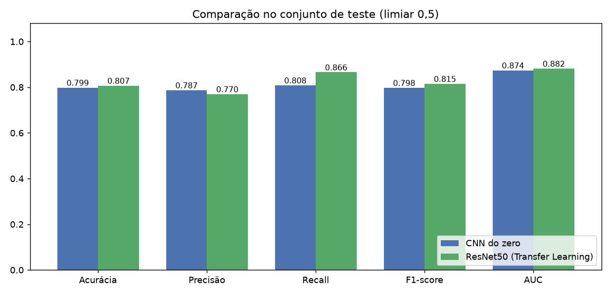
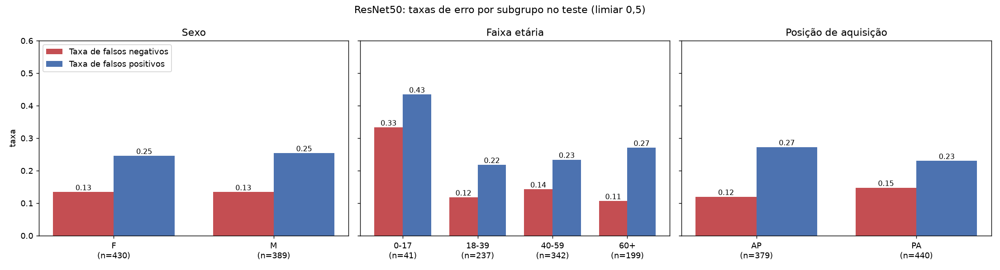
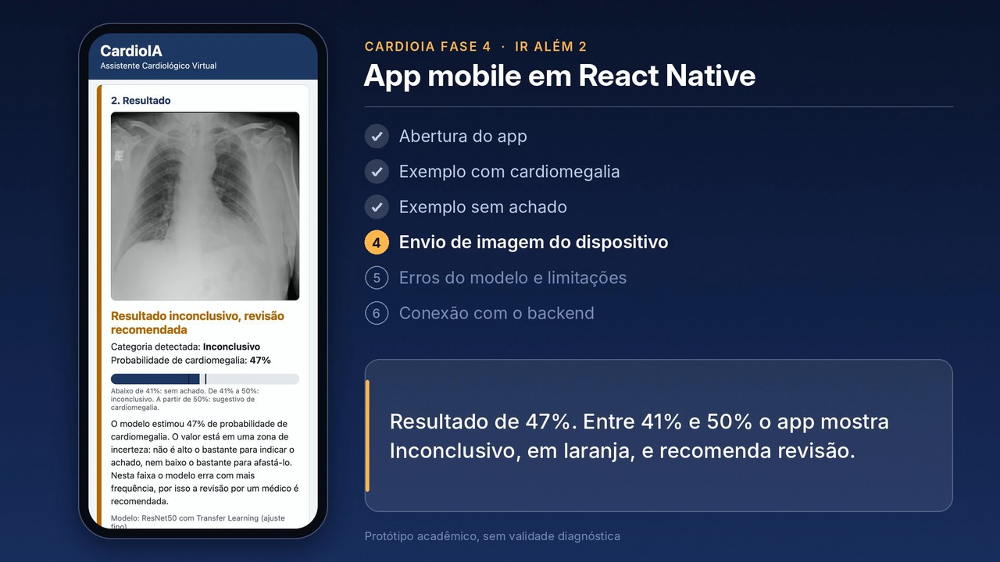

# CardioIA Fase 4: Assistente Cardiológico Virtual com Visão Computacional

FIAP, Inteligência Artificial, turma 2TIAOR, Fase 4, Cap 1 (Visão Computacional na Clínica)

> **Aviso:** protótipo acadêmico, sem validade diagnóstica. Usa apenas dados públicos e anonimizados. Não substitui a avaliação de um médico.

## Grupo 15

## Integrantes

| Nome | RM |
|---|---|
| Silvio Prestes Guerreiro Junior | 567958 |

Entrega individual.

## Professores

- Tutor: [Leonardo Ruiz Orabona](https://www.linkedin.com/in/leonardoorabona)
- Coordenador: [André Godoi Chiovato](https://www.linkedin.com/company/inova-fusca)

## Objetivo

Protótipo que recebe uma radiografia de tórax e estima a probabilidade de **cardiomegalia** (coração aumentado). O projeto cobre o pré-processamento das imagens, o treino e a avaliação de duas redes convolucionais (uma CNN simples treinada do zero e uma ResNet50 com Transfer Learning) e uma interface web simples para apresentar o resultado em linguagem acessível.

## Dataset

**NIH Chest X-ray (ChestX-ray14)**, do NIH Clinical Center: 112.120 radiografias frontais de 30.805 pacientes anonimizados, com 14 achados rotulados por mineração de texto dos laudos, mais idade, sexo e posição de aquisição.

- Fonte original: https://nihcc.app.box.com/v/ChestXray-NIHCC
- Fonte usada no download: espelho público em https://huggingface.co/datasets/alkzar90/NIH-Chest-X-ray-dataset
- Licença: uso sem restrições, com atribuição ao NIH Clinical Center e citação do artigo abaixo.
- Citação: Wang X, Peng Y, Lu L, Lu Z, Bagheri M, Summers RM. ChestX-ray8: Hospital-scale Chest X-ray Database and Benchmarks on Weakly-Supervised Classification and Localization of Common Thorax Diseases. IEEE CVPR 2017.

**Subconjunto usado:** 5.552 imagens de 4.342 pacientes, 2.776 de Cardiomegalia e 2.776 Sem achado. As negativas foram pareadas com as positivas por posição de aquisição (AP ou PA), sexo e faixa etária. A divisão em treino (3.928), validação (805) e teste (819) foi feita **por paciente**, sem paciente repetido entre conjuntos.

**Modelo pré-treinado:** ResNet50 com pesos do ImageNet, via Keras Applications (licença Apache 2.0).

## Estrutura de pastas

```
cardioia-fase4/
  notebooks/
    01_preprocessamento.ipynb          Parte 1: seleção, amostragem, divisão, redimensionamento, normalização
    02_cnn_do_zero.ipynb               Parte 2: CNN simples treinada do zero e avaliação
    03_transfer_learning.ipynb         Parte 2: ResNet50 (extração de características e ajuste fino) e comparação
    03b_comparacao_estatistica.ipynb   Intervalos de confiança e teste de McNemar entre os modelos
    04_fairness.ipynb                  Ir Além 1: limitações do dataset, métricas de fairness e mitigação
  app/                                 Protótipo Flask (página web e API JSON)
  mobile/                              Ir Além 2: app React Native (Expo), README próprio e roteiro do vídeo
  src/nih_remoto.py                    Download seletivo das imagens do NIH
  src/experimento_jpeg.py              Robustez: efeito de omitir a etapa JPEG do pré-processamento
  relatorios/relatorio_preprocessamento.docx
  relatorios/relatorio_fairness.docx   Ir Além 1
  docs/teste_colab_2026-11-20.md       Registro do teste de execução no Google Colab
  prints/                              Figuras e prints das métricas e do protótipo
  data/                                Metadados, manifesto, previsões e resultados (imagens ficam fora do repositório)
  models/                              Modelos treinados (fora do repositório)
  requirements.txt
```

## Resultados

Avaliação no conjunto de teste (819 imagens, 652 pacientes não vistos no treino), com limiar de decisão 0,5. Entre colchetes, o intervalo de confiança de 95% por bootstrap sobre pacientes.

| Métrica | CNN do zero | ResNet50 (Transfer Learning) |
|---|---|---|
| Acurácia | 0,799 [0,768 a 0,829] | 0,807 [0,776 a 0,836] |
| Precisão | 0,787 [0,734 a 0,833] | 0,770 [0,717 a 0,814] |
| Recall | 0,808 [0,758 a 0,851] | 0,866 [0,825 a 0,901] |
| F1-score | 0,798 [0,754 a 0,834] | 0,815 [0,774 a 0,848] |
| AUC | 0,874 [0,845 a 0,900] | 0,882 [0,855 a 0,906] |
| Falsos negativos / falsos positivos | 77 / 88 | 54 / 104 |
| Parâmetros | 3,45 milhões | 24,1 milhões |
| Épocas e tempo de treino (CPU, Apple M5) | 40 épocas, 33,1 min | 17 épocas, 31,6 min |

**Leitura.** Os dois modelos têm desempenho estatisticamente equivalente em acurácia, F1 e AUC (os intervalos da diferença incluem o zero; McNemar p = 0,61). A ResNet50 tem recall maior no limiar 0,5 (+5,7 pontos), com especificidade menor. Ela foi escolhida para o protótipo por ter o maior AUC de validação e o maior recall, métrica prioritária em triagem, já que o falso negativo é o erro mais grave. Em um segundo treino completo, feito no Google Colab, a diferença de recall caiu para 0,7 ponto e deixou de ser distinguível, portanto essa vantagem depende do treino (ver Teste no Google Colab). Só a extração de características, sem ajuste fino, ficou abaixo da CNN do zero (AUC de validação de 0,822).

Prints das métricas: `prints/06` a `prints/12`. Prints do protótipo: `prints/13` e `prints/14`.



## Protótipo

Aplicação Flask em `app/`. A página recebe uma radiografia (PNG ou JPG) e mostra a classe prevista, a probabilidade, uma barra com as faixas de decisão, uma explicação em linguagem acessível e as limitações do modelo. O resultado é apresentado em três faixas:

| Probabilidade | Resultado |
|---|---|
| abaixo de 41% | Sem achado |
| de 41% a 50% | Inconclusivo, revisão recomendada |
| a partir de 50% | Sugestivo de cardiomegalia |

O limite de 41% foi escolhido no conjunto de validação para manter recall de pelo menos 90%. Há também uma API JSON (`POST /api/predict`, campo `imagem`), consumida pelo app mobile (Ir Além 2).


## Como executar

Testado em macOS (Apple M5) com Python 3.12 e no Google Colab com Python 3.13 (ver a seção Teste no Google Colab). O protótipo e os notebooks 03b e 04 também foram executados em um ambiente novo, criado com os comandos abaixo.

```bash
python3.12 -m venv .venv && source .venv/bin/activate
pip install -r requirements.txt

# 1. Notebooks, na ordem (o 01 baixa cerca de 2,2 GB de imagens na primeira execução)
cd notebooks
export CARDIOIA_RAW=~/cardioia-data/raw     # opcional: pasta de cache das imagens originais
jupyter nbconvert --to notebook --execute --inplace 01_preprocessamento.ipynb
jupyter nbconvert --to notebook --execute --inplace 02_cnn_do_zero.ipynb
jupyter nbconvert --to notebook --execute --inplace 03_transfer_learning.ipynb
jupyter nbconvert --to notebook --execute --inplace 03b_comparacao_estatistica.ipynb
jupyter nbconvert --to notebook --execute --inplace 04_fairness.ipynb

# 2. Protótipo (para usar sem retreinar, baixe o modelo treinado: ver seção "Modelo treinado")
cd ../app
python app.py                               # abre em http://127.0.0.1:5050
./testar_api.sh                             # teste rápido da API, em outro terminal
```

Sementes fixas (42) em todas as etapas. Em CPU, os resultados de treino podem variar ligeiramente entre máquinas.

## Teste no Google Colab

Em 20/11/2026 os cinco notebooks foram executados no Google Colab, em ordem e na mesma máquina, a partir de uma cópia dos arquivos deste repositório colocada em `/content`, sem instalar nenhum pacote. Ambiente: GPU Tesla T4, Python 3.13.16, TensorFlow 2.21.0, Keras 3.13.2, numpy 2.4.6, pandas 2.2.3 e OpenCV 4.14.0. A execução completa levou 71,6 minutos. O registro, com as saídas, está em `docs/teste_colab_2026-11-20.md`.

| Item | Execução local (Apple M5, CPU) | Google Colab (GPU T4) |
|---|---|---|
| Seleção e divisão das imagens (manifesto) | referência | idêntico |
| 5.552 imagens processadas | referência | idênticas, byte a byte |
| CNN do zero no teste: acurácia, recall e AUC | 0,799, 0,808 e 0,874 | 0,805, 0,823 e 0,877 |
| ResNet50 no teste: acurácia, recall e AUC | 0,807, 0,866 e 0,882 | 0,807, 0,831 e 0,879 |
| Tempo de treino da CNN do zero e da ResNet50 | 33,1 min e 31,6 min | 37,5 min e 19,9 min |

O que o teste mostrou:

- **A Parte 1 se reproduz exatamente.** O Colab seleciona as mesmas imagens, faz a mesma divisão e gera os mesmos arquivos processados.
- **Os resultados dos modelos ficam próximos, mas não iguais.** O treino foi refeito com o mesmo código e a mesma semente, em outro hardware. A acurácia mudou no máximo 0,006 e o AUC, 0,003.
- **A vantagem de recall da ResNet50 não se repetiu.** No Colab a diferença para a CNN do zero foi de 0,7 ponto, com intervalo de confiança de -3,3 a +4,8 pontos. Na execução local tinha sido de 5,7 pontos.
- **O recall baixo da ResNet50 na faixa de 0 a 17 anos se repetiu** (ver Ir Além 1).
- **O download pode esbarrar no limite de requisições do servidor.** Na primeira passagem, 36 das 5.552 imagens foram recusadas com o erro 429 e o notebook 01 parou na verificação do download. A segunda tentativa retomou de onde parou e terminou em 1,5 minuto. Depois do teste, `src/nih_remoto.py` passou a esperar e a tentar de novo, sozinho, as imagens recusadas.

Para repetir o teste, em um notebook do Colab com GPU:

```
!git clone https://github.com/silvioguerreiro/FIAP_2TIAOR_2026_Ano2_Fase4_Cap1_Visao_Computacional_na_Clinica.git cardioia
%cd cardioia/notebooks
!jupyter nbconvert --to notebook --execute --inplace 01_preprocessamento.ipynb
```

O mesmo comando vale para os outros notebooks, na ordem.

## Modelo treinado

Os arquivos de modelo passam de 100 MB e não ficam no repositório. Para abrir o protótipo sem executar os notebooks de treino, baixe `resnet50_final.keras` na [pasta compartilhada do OneDrive](https://1drv.ms/f/c/a655986124216a70/IgB2ySRcJ2-IR7UQIerYZWg9AaFNm9sAIeP-E-NKlcwKu5E?e=ObLTH3) e salve em `models/resnet50_final.keras`.

## Ir Além 1: ética e governança

Análise em `notebooks/04_fairness.ipynb` e `relatorios/relatorio_fairness.docx`. Métricas da ResNet50 no teste, por subgrupo. O valor p vem de um teste de permutação por paciente (100.000 repetições), em que os resultados do modelo são trocados entre pacientes da mesma classe e com o mesmo número de imagens.

| Atributo | Diferença de recall (igualdade de oportunidade) | Diferença de FPR | Leitura |
|---|---|---|---|
| Sexo | 0,000 (p = 1,00) | 0,008 (p = 0,91) | Sem disparidade |
| Posição de aquisição (AP x PA) | 0,028 (p = 0,74) | 0,042 (p = 0,36) | Sem disparidade detectável |
| Faixa etária | 0,227 (p = 0,012) | 0,217 (p = 0,052) | Alerta na faixa de 0 a 17 anos, inconclusivo |

Na faixa de 0 a 17 anos o recall no teste foi de 66,7%, contra 85,7% a 89,3% nas faixas adultas. O resultado se apoia em poucos pacientes: as 18 imagens positivas dessa faixa vêm de 6 pacientes, e os 6 falsos negativos, de 4 deles. Em um esquema de permutação mais simples o valor p sobe para 0,046, e a queda não se repetiu na validação (10 imagens positivas de 10 pacientes, 9 detectadas). Em um segundo treino da ResNet50, feito no Google Colab com o mesmo código e a mesma semente, o recall dessa faixa no teste foi de 50,0% (p = 0,003) e a CNN do zero voltou a não mostrar a queda (88,9%). A queda, portanto, não é exclusiva de uma execução, mas continua apoiada nos mesmos 6 pacientes. Com estes dados não é possível dizer se ela vale para pacientes pediátricos em geral. Fica registrado que **o modelo não está validado para menores de 18 anos**, e o protótipo informa isso na tela.



## Ir Além 2: app mobile

App React Native (Expo) em `mobile/`, que consome a API Flask e exibe a categoria detectada, a probabilidade e a explicação. A demonstração é feita na versão web do app (React Native Web), em tela de celular, servida pelo próprio Flask em `/mobile/`. Instruções em `mobile/README.md`.

Vídeo de demonstração (2 minutos, com legendas, sem narração): `mobile/video/cardioia_mobile_demo.mp4`. Link para assistir: https://youtu.be/Tj1SdRtDy8o



## Limitações

- **Rótulos com ruído:** foram extraídos dos laudos por processamento de linguagem natural, sem revisão por radiologistas. Isso limita o desempenho mensurável de qualquer modelo.
- **Balanceamento artificial:** o conjunto tem 50% de positivos, enquanto a Cardiomegalia aparece em menos de 3% das imagens do dataset. Na prevalência real, a precisão seria muito menor.
- **Classe negativa só com imagens sem achado:** as negativas do treino e do teste são radiografias rotuladas como "No Finding". O modelo não foi avaliado em radiografias com outros achados e sem cardiomegalia, e nesses casos pode gerar mais falsos positivos do que os medidos aqui.
- **Um único hospital:** todas as imagens vêm do NIH Clinical Center, nos Estados Unidos. Não há validação externa.
- **Escopo:** o modelo só avalia cardiomegalia e não informa em que região da imagem se baseou.
- **Falsos negativos:** mesmo no ponto mais sensível testado, cerca de 10% dos casos de Cardiomegalia do teste não foram detectados.
- **Pacientes pediátricos:** desempenho não validado para menores de 18 anos (4,8% das imagens do dataset).
- **Atributos ausentes:** o dataset não traz raça, etnia nem condição socioeconômica, o que impede medir viés nessas dimensões.
- **Sensibilidade à compressão JPEG:** a ResNet50 foi treinada e avaliada apenas com imagens que passaram pela etapa JPEG (qualidade 95) do pré-processamento. Sem essa etapa, a probabilidade muda em média 0,024 e até 0,189 no conjunto de teste, e 19 das 819 imagens trocam de lado no limiar 0,5 (acurácia de 0,807 para 0,799). A CNN do zero quase não muda (diferença máxima de 0,007). O protótipo repete a etapa JPEG ao receber uma imagem original, de modo que suas respostas coincidem com as do notebook (`src/experimento_jpeg.py`).
- **Poucos treinos por modelo:** cada modelo foi treinado duas vezes com a mesma semente, uma na execução local e outra no Google Colab. Entre os dois treinos o AUC mudou no máximo 0,003, mas o recall no limiar 0,5 mudou até 3,5 pontos. A variação entre sementes não foi estimada.
