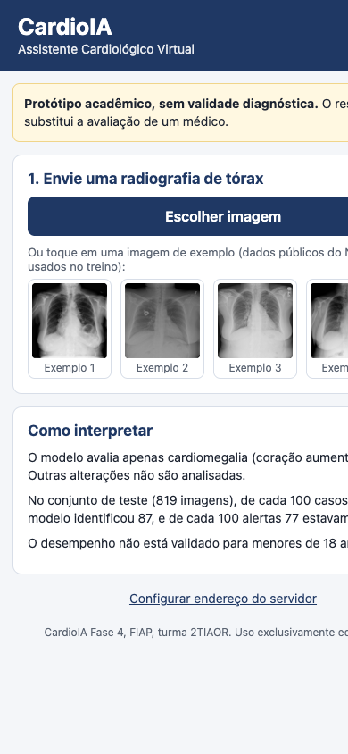

# CardioIA Mobile (Ir Além 2)

App React Native (Expo) que envia uma radiografia de tórax ao backend Flask e exibe a categoria detectada pela CNN: **Sem achado**, **Inconclusivo** ou **Cardiomegalia**, com a probabilidade e uma explicação em linguagem acessível.

> Protótipo acadêmico, sem validade diagnóstica.



## Arquitetura

```
App React Native (mobile/App.js)  --POST /api/predict (multipart, campo "imagem")-->  Flask (app/app.py)  -->  ResNet50 (models/resnet50_final.keras)
```

Endpoints usados pelo app:

| Método e rota | Função |
|---|---|
| `GET /api/info` | Limites de decisão, métricas do modelo e lista de imagens de exemplo |
| `POST /api/predict` | Recebe a imagem e devolve classe, probabilidade, faixa e explicação |
| `GET /api/exemplo/<nome>` | Analisa uma das imagens de exemplo servidas pelo backend |

## Como a demonstração é feita

A demonstração e o vídeo usam a **versão web** do app (React Native Web), aberta no navegador em tela de celular. O código é o mesmo que roda em iOS e Android pelo Expo; a execução nativa não foi testada neste trabalho.

## Como executar

Testado com Node.js 24 e Expo SDK 58. Requer o backend em execução.

```bash
# Terminal 1: backend
cd app && python app.py                     # http://127.0.0.1:5050

# Terminal 2: app
cd mobile
npm install
npx expo start
```

Com o Expo aberto, tecle `i` para o simulador iOS (requer Xcode), `a` para o emulador Android (requer Android Studio) ou `w` para abrir no navegador. Em celular físico, use o app Expo Go e informe o IP do computador em "Configurar endereço do servidor" (inicie o backend com `HOST=0.0.0.0 python app.py`).

Endereço padrão do backend em cada plataforma: `10.0.2.2:5050` no emulador Android, `127.0.0.1:5050` no simulador iOS e o mesmo host da página no navegador.

### Versão web servida pelo próprio Flask

```bash
cd mobile && npx expo export --platform web
rm -rf ../app/mobile_web && cp -R dist ../app/mobile_web
cd ../app && python app.py                  # abra http://127.0.0.1:5050/mobile/
```

## O que foi testado

- Versão web (React Native Web), servida pelo Flask, em tela de celular (390 x 844), com o Chrome em modo automatizado (`video/gravar_demo.py`): carregamento, conexão com a API, análise de três imagens de exemplo, envio de arquivo pelo botão Escolher imagem, rolagem automática até o resultado e teste de conexão. As probabilidades exibidas (88%, 34%, 47% e 97%) coincidem com as gravadas no notebook 03.
- **Não testado:** execução nativa em simulador iOS e em emulador Android.

## Vídeo de demonstração

Link para assistir: https://youtu.be/Tj1SdRtDy8o

`video/cardioia_mobile_demo.mp4` (2 minutos, 1920 x 1080, legendas na imagem, sem narração) e `video/cardioia_mobile_demo.srt` (as mesmas legendas em arquivo separado).

A gravação da tela é real. O script `video/gravar_demo.py` abre o app no Chrome com o Playwright, executa os toques do roteiro e captura a tela em 780 x 1688. O script `video/montar_video.py` acrescenta a moldura de celular, o roteiro e as legendas. O círculo laranja marca o ponto de cada toque. O roteiro, com os tempos e os textos, está em `ROTEIRO_VIDEO.md`.

```bash
pip install playwright imageio-ffmpeg
python video/gravar_demo.py --imagem ~/cardioia-data/raw/00004630_002.png --esperado 47   # backend em execução
python video/montar_video.py render                                                       # requer ffmpeg e as fontes Inter
```
